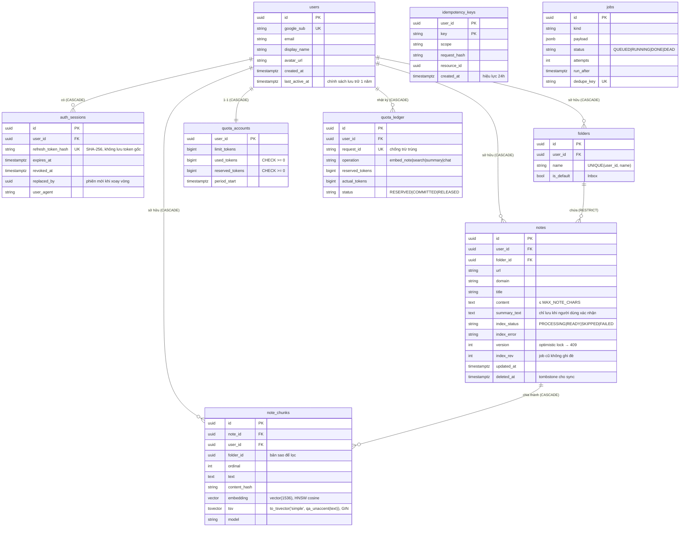

# A01 — Sơ đồ thực thể (ERD) & quy ước migration

> Khớp `apps/api/src/quickassist/data/models/` và migration `0001` + `0002` (đã chạy `alembic check` = không lệch). Đối chiếu SDS v1.1 §6.

`idempotency_keys` và `jobs` không có FK tới `users` (khoá chính/payload chứa id) — xoá tài khoản vẫn sạch vì: idempotency hết hạn sau 24h; job index của note đã xoá tự dọn chunk (note không còn → `delete_for_note`).

## Chỉ mục
`notes(user_id, updated_at, id)` (sync/phân trang cursor) · `notes(user_id, folder_id)` · `note_chunks(user_id, folder_id)` · HNSW `note_chunks.embedding vector_cosine_ops` · GIN `note_chunks.tsv` · `jobs(status, run_after)` · `auth_sessions(user_id)` · `quota_ledger(user_id)`.

## Sở hữu bảng (luật L4)
| Bảng | Service (business/) | Repository |
|---|---|---|
| users, auth_sessions | auth | user_repository, auth_session_repository |
| folders, notes | notes | folder_repository, note_repository |
| note_chunks | semantic_search | note_chunk_repository |
| quota_accounts, quota_ledger | quota | quota_repository |
| idempotency_keys | common | idempotency_repository |
| jobs | infrastructure/jobs | (queue.py) |

## Quy ước migration theo service
| Quy tắc | Ví dụ |
|---|---|
| Tên file: `YYYYMMDD_NNNN_<service>_<mô tả>.py`, message bắt đầu bằng tên service | `20261008_0002_search_unaccent.py` — "semantic_search: …" |
| Chỉ sửa bảng của service mình; bảng mới khai báo trong `data/models/` | |
| Không sửa migration đã merge — tạo migration mới | |
| Phải có `downgrade()` chạy được — CI chạy `upgrade → check → downgrade base → upgrade` | |
| Hai người cùng thêm migration → `alembic heads` ra 2 head → sửa `down_revision` của migration MỚI hơn | CONTRIBUTING.md |
| Extension Postgres cần dùng (`vector`, `unaccent`) tạo trong migration bằng `CREATE EXTENSION IF NOT EXISTS` | |
