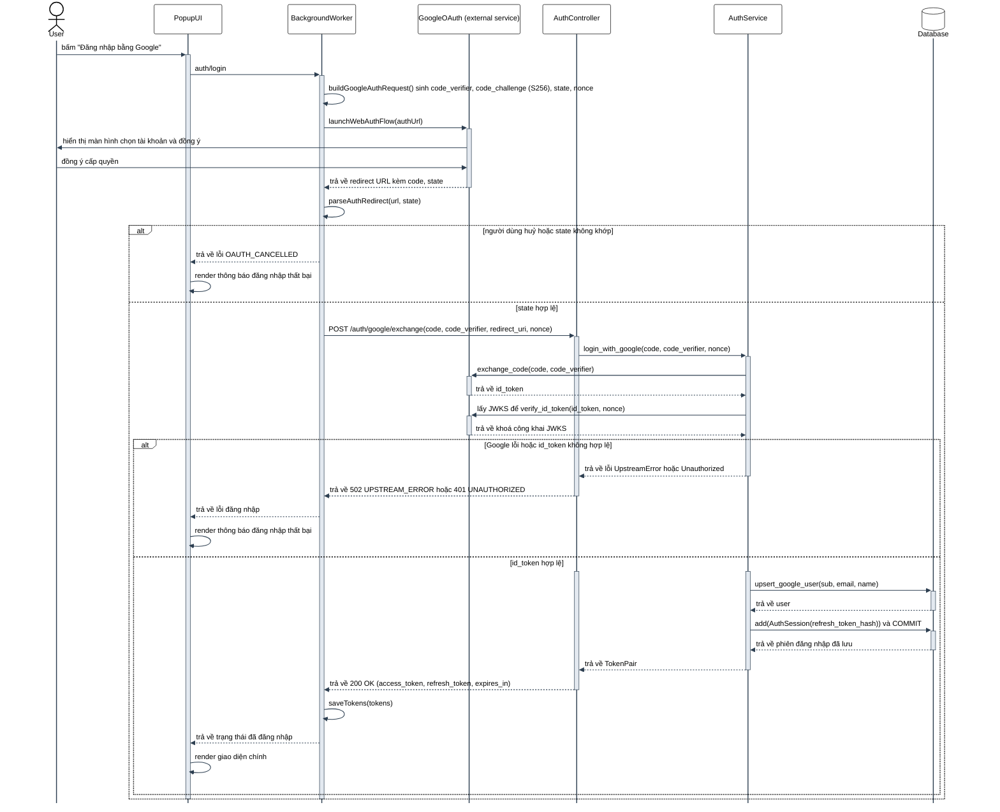
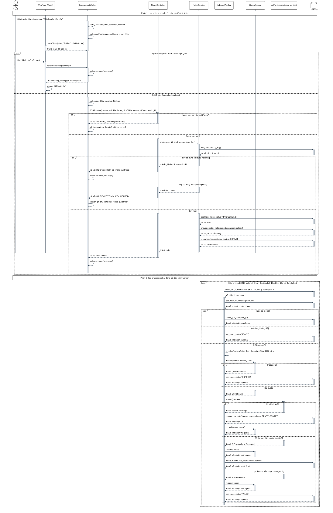
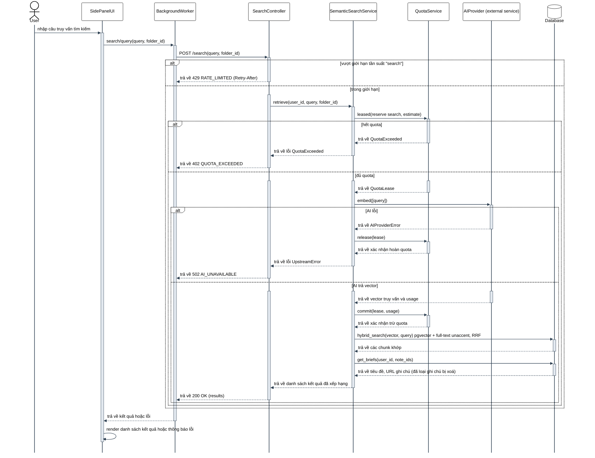
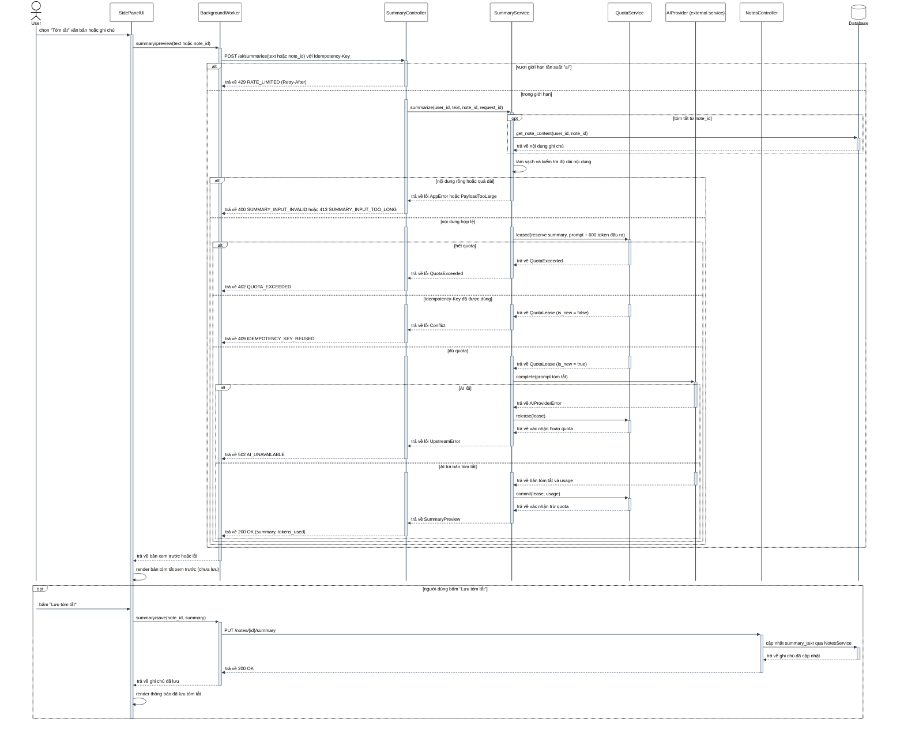
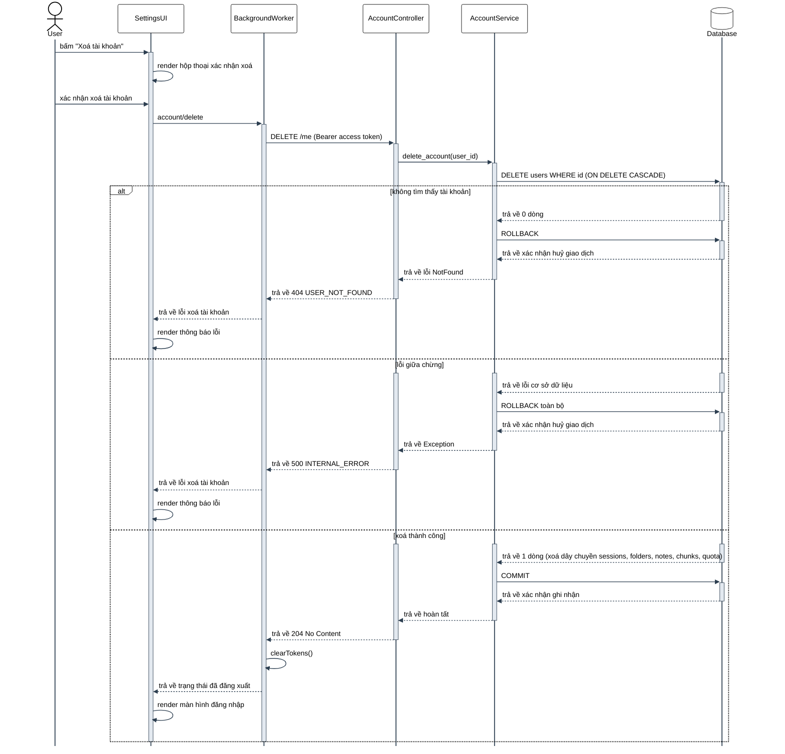
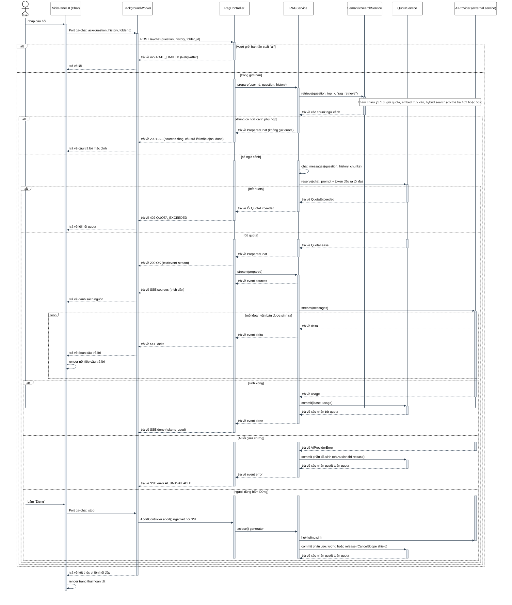
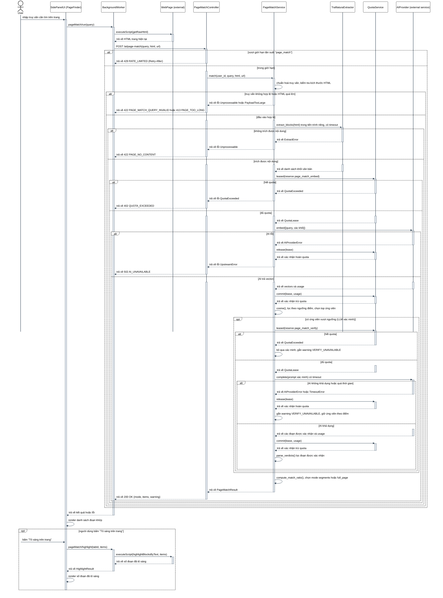
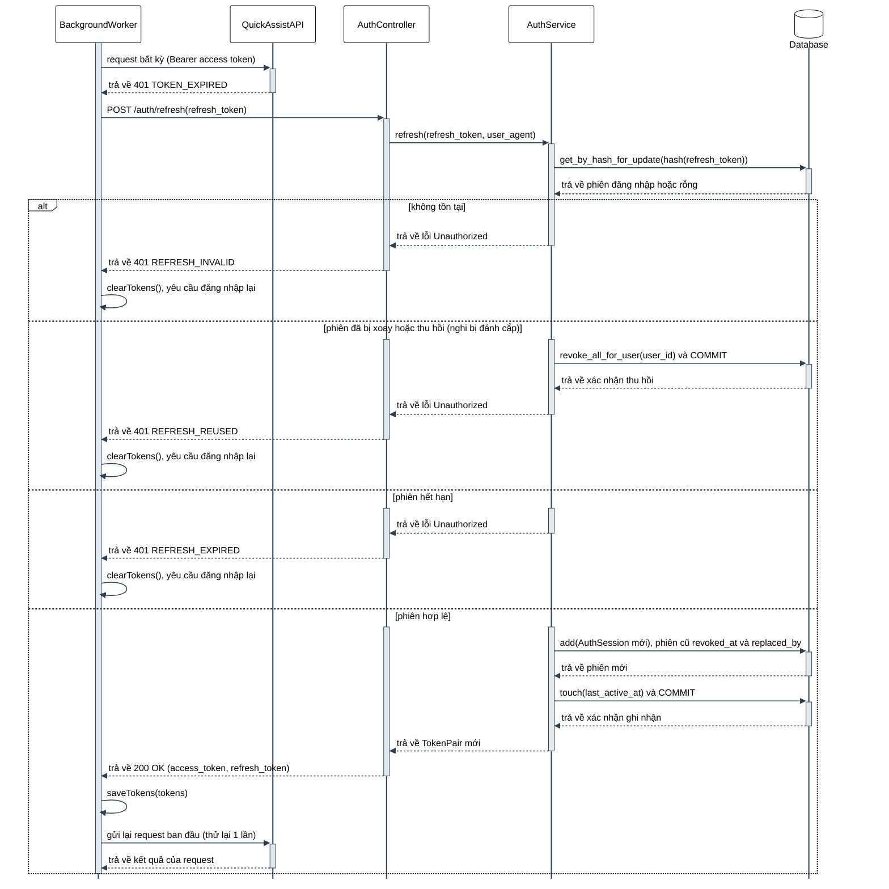
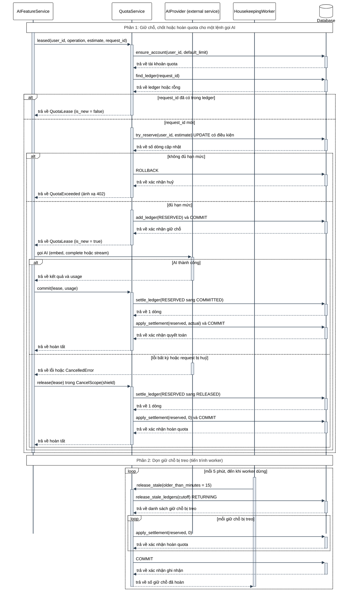

# Sơ đồ tuần tự — SDS §5.1.1 đến §5.1.9

> Vẽ theo code hiện tại (`apps/api`, `apps/extension`). Ký pháp dựa trên SDS của nhóm 08 (PlantUML, UML 2.5), viết lại bằng Mermaid.
> **Bản giống hệt phong cách nhóm 08 (PlantUML):** [sequence/](sequence/) — mỗi mục một file `5_1_x.puml`, mỗi file tự chứa đủ style và màu (mở được trong VS Code PlantUML lẫn draw.io). Xuất PNG để chèn vào SDS.
> Cần Mermaid **≥ 11.12** để hiển thị lifeline `Database` dạng hình trụ (mermaid.live dùng được; một số trình xem cũ sẽ báo lỗi ở dòng `Database@{ "type" : "database" }`).

## Quy ước ký pháp

| Thành phần | Quy ước |
|---|---|
| Lifeline | `User` là actor (hình người); `Database` là hình trụ, đặt ngoài cùng bên phải; hệ thống bên ngoài có hậu tố `(external service)`. Tên thành phần theo tên trong code (CamelCase). |
| Lời gọi đồng bộ | Nét liền `->>`. Nhãn là tên hàm/endpoint/thông điệp thật kèm tham số: `retrieve(user_id, query)`, `POST /search`, `search/query`. |
| Phản hồi | Nét đứt `-->>`. Nhãn bắt đầu bằng "trả về …", kèm HTTP status và mã lỗi nếu có: `trả về 402 QUOTA_EXCEEDED`. |
| Xử lý nội bộ | Tự gọi (self-message): `SVC->>SVC: compute_match_ratio()`, `UI->>UI: render …`. |
| Thanh kích hoạt | Bật khi nhận lời gọi (`->>+`), tắt khi trả về (`-->>-`). |
| Khung kết hợp | `alt`/`else` cho rẽ nhánh có điều kiện; `opt` cho luồng tuỳ chọn một nhánh; `loop` cho lặp (worker retry, stream). Điều kiện ghi trong `[...]`. |
| Chia phần | Sơ đồ nhiều giai đoạn dùng `Note over` trải ngang toàn bộ lifeline, thay cho `== … ==` của PlantUML. |
| Mô tả kèm sơ đồ | Mỗi sơ đồ có 4 mục: **Công nghệ**, **Kích hoạt**, **Chức năng**, **Luồng hoạt động** (mỗi gạch đầu dòng ứng với một mũi tên, nhánh ghi "Nhánh điều kiện [...]"). |

---

## 5.1.1 Đăng nhập bằng Google OAuth

- **Công nghệ:** `chrome.identity.launchWebAuthFlow`, OAuth 2.0 Authorization Code + PKCE (S256), Google OIDC (JWKS), JWT, PostgreSQL (`users`, `auth_sessions`).
- **Kích hoạt:** Người dùng bấm "Đăng nhập bằng Google" trên Popup.
- **Chức năng:** Xác thực bằng Google mà không lưu mật khẩu; server đổi code lấy `id_token`, kiểm chứng chữ ký và `nonce`, rồi phát phiên riêng của ứng dụng (access token ngắn hạn + refresh token xoay vòng).
- **Luồng hoạt động:**
  - User bấm "Đăng nhập bằng Google" trên PopupUI.
  - PopupUI gửi thông điệp `auth/login` tới BackgroundWorker.
  - BackgroundWorker tự sinh `code_verifier`, `code_challenge` (S256), `state`, `nonce` qua `buildGoogleAuthRequest()`.
  - BackgroundWorker gọi `launchWebAuthFlow(authUrl)` tới GoogleOAuth (external service).
  - GoogleOAuth hiển thị màn hình chọn tài khoản; User đồng ý cấp quyền.
  - GoogleOAuth trả về redirect URL kèm `code`, `state` cho BackgroundWorker.
  - BackgroundWorker tự kiểm tra `state` qua `parseAuthRedirect(url, state)`.
  - Nhánh điều kiện [người dùng huỷ hoặc state không khớp]:
    - BackgroundWorker trả về lỗi `OAUTH_CANCELLED` cho PopupUI; PopupUI tự render thông báo thất bại.
  - Nhánh điều kiện [state hợp lệ]:
    - BackgroundWorker gọi `POST /auth/google/exchange` tới AuthController; AuthController gọi `login_with_google()` tới AuthService.
    - AuthService gọi `exchange_code()` tới GoogleOAuth và nhận về `id_token`; sau đó lấy JWKS để `verify_id_token(id_token, nonce)`.
    - Nhánh con [Google lỗi hoặc id_token không hợp lệ]: AuthService trả lỗi; AuthController trả `502 UPSTREAM_ERROR` hoặc `401 UNAUTHORIZED`; PopupUI render thông báo thất bại.
    - Nhánh con [id_token hợp lệ]: AuthService gọi `upsert_google_user()` rồi `add(AuthSession)` và COMMIT vào Database; trả `TokenPair`; AuthController trả `200 OK`; BackgroundWorker tự `saveTokens()`; PopupUI render giao diện chính.

---

## 5.1.2 Lưu ghi chú và tạo embedding

- **Công nghệ:** `chrome.contextMenus`, `chrome.alarms`, IndexedDB (outbox), FastAPI, Idempotency-Key, PostgreSQL job queue (`FOR UPDATE SKIP LOCKED`, outbox pattern), pgvector, AI Embedding API.
- **Kích hoạt:** Người dùng bôi đen văn bản và chọn "Ghi chú văn bản này" (menu chuột phải hoặc phím tắt).
- **Chức năng:** Lưu ghi chú ngay ở client với 5 giây để hoàn tác, gửi lên server không bị trùng (Idempotency-Key), rồi tạo embedding bất đồng bộ ở worker có retry và kiểm soát quota.
- **Luồng hoạt động:**
  - **Phần 1:** User chọn menu "Ghi chú văn bản này"; BackgroundWorker tự `startQuickNote()` và `outbox.put()` với hạn gửi sau 5 giây; BackgroundWorker gọi `showToast()` hiện toast có nút Hoàn tác trên WebPage.
  - Nhánh điều kiện [người dùng bấm Hoàn tác trong 5 giây]: WebPage gửi `quickNote/undo` tới BackgroundWorker; BackgroundWorker tự `outbox.remove()` và trả về đã huỷ; WebPage render "Đã hoàn tác".
  - Nhánh điều kiện [hết 5 giây]: BackgroundWorker gọi `POST /notes` kèm Idempotency-Key tới NotesController.
    - Nhánh con [vượt tần suất]: trả `429 RATE_LIMITED`; BackgroundWorker giữ mục trong outbox để thử lại.
    - Nhánh con [trong giới hạn]: NotesController gọi `create()` tới NotesService; NotesService tra `idempotency_key` trong Database.
      - [cùng key, cùng nội dung]: trả `201 Created` với bản đã tạo.
      - [cùng key, khác nội dung]: trả `409 IDEMPOTENCY_KEY_REUSED`; BackgroundWorker chuyển ghi chú sang mục "chưa gửi được".
      - [key mới]: NotesService ghi note (`PROCESSING`), job `index_note` và idempotency key trong cùng một transaction rồi COMMIT; trả `201 Created`; BackgroundWorker tự xoá mục khỏi outbox.
  - **Phần 2 (khung loop):** IndexingWorker claim job từ Database, đọc note và `content_hash`.
    - [note đã bị xoá]: xoá chunk. [nội dung không đổi]: đặt `READY`, không tốn quota.
    - [nội dung mới]: IndexingWorker tự chia đoạn, gọi `leased()` tới QuotaService.
      - [hết quota]: đặt `SKIPPED`.
      - [đủ quota]: gọi `embed(chunks)` tới AIProvider. [thành công]: ghi chunk + embedding, `READY`, `commit()` quota. [lỗi tạm thời, còn lượt]: `release()` quota, job quay về `QUEUED` với backoff. [lỗi vĩnh viễn hoặc hết lượt]: `release()` quota, đặt `FAILED`.

---

## 5.1.3 Tìm kiếm ngữ nghĩa

- **Công nghệ:** AI Embedding API, PostgreSQL + pgvector (cosine), full-text search có `unaccent`, Reciprocal Rank Fusion (RRF).
- **Kích hoạt:** Người dùng nhập truy vấn trong ô tìm kiếm của Side Panel.
- **Chức năng:** Tìm ghi chú theo ý nghĩa (kể cả gõ không dấu), kết hợp tìm vector và tìm từ khoá, trừ quota theo token thực tế.
- **Luồng hoạt động:**
  - User nhập truy vấn trên SidePanelUI; SidePanelUI gửi `search/query` tới BackgroundWorker; BackgroundWorker gọi `POST /search` tới SearchController.
  - Nhánh điều kiện [vượt tần suất]: SearchController trả `429 RATE_LIMITED`.
  - Nhánh điều kiện [trong giới hạn]: SearchController gọi `retrieve()` tới SemanticSearchService; SemanticSearchService gọi `leased()` tới QuotaService.
    - Nhánh con [hết quota]: trả `402 QUOTA_EXCEEDED`.
    - Nhánh con [đủ quota]: SemanticSearchService gọi `embed([query])` tới AIProvider.
      - [AI lỗi]: `release()` quota; trả `502 AI_UNAVAILABLE`.
      - [AI trả vector]: `commit()` quota; gọi `hybrid_search()` rồi `get_briefs()` tới Database; trả `200 OK` kèm kết quả đã xếp hạng.
  - BackgroundWorker trả kết quả cho SidePanelUI; SidePanelUI tự render danh sách hoặc thông báo lỗi.

---

## 5.1.4 Tóm tắt nội dung bằng AI

- **Công nghệ:** AI Chat Completion API, prompt có rào chắn nội dung không tin cậy, Idempotency-Key, quota giữ chỗ/chốt.
- **Kích hoạt:** Người dùng chọn "Tóm tắt" (menu chuột phải trên văn bản hoặc nút trên ghi chú).
- **Chức năng:** Sinh bản tóm tắt xem trước (không ghi DB); chỉ lưu vào ghi chú khi người dùng xác nhận.
- **Luồng hoạt động:**
  - User chọn "Tóm tắt"; SidePanelUI gửi `summary/preview` tới BackgroundWorker; BackgroundWorker gọi `POST /ai/summaries` tới SummaryController.
  - Nhánh điều kiện [vượt tần suất]: trả `429 RATE_LIMITED`.
  - Nhánh điều kiện [trong giới hạn]: SummaryController gọi `summarize()` tới SummaryService.
    - Nhánh tuỳ chọn [tóm tắt từ note_id]: SummaryService đọc nội dung ghi chú từ Database.
    - SummaryService tự làm sạch và kiểm tra độ dài. [rỗng hoặc quá dài]: trả `400` hoặc `413`.
    - [nội dung hợp lệ]: SummaryService gọi `leased()` tới QuotaService.
      - [hết quota]: trả `402 QUOTA_EXCEEDED`. [Idempotency-Key đã dùng]: trả `409 IDEMPOTENCY_KEY_REUSED`.
      - [đủ quota]: gọi `complete()` tới AIProvider. [AI lỗi]: `release()` quota, trả `502 AI_UNAVAILABLE`. [AI trả kết quả]: `commit()` quota, trả `200 OK` kèm bản tóm tắt.
  - SidePanelUI render bản xem trước.
  - Nhánh tuỳ chọn [người dùng bấm "Lưu tóm tắt"]: SidePanelUI gửi `summary/save`; BackgroundWorker gọi `PUT /notes/{id}/summary` tới NotesController; NotesController cập nhật `summary_text` trong Database; trả `200 OK`; SidePanelUI render thông báo đã lưu.

---

## 5.1.5 Xoá tài khoản và dữ liệu

- **Công nghệ:** PostgreSQL (khoá ngoại `ON DELETE CASCADE`, một transaction), `chrome.storage`.
- **Kích hoạt:** Người dùng bấm "Xoá tài khoản" trong trang Cài đặt và xác nhận.
- **Chức năng:** Xoá vĩnh viễn tài khoản và toàn bộ dữ liệu liên quan (phiên, thư mục, ghi chú, chunk/vector, quota) trong một transaction; lỗi giữa chừng thì rollback toàn bộ.
- **Luồng hoạt động:**
  - User bấm "Xoá tài khoản"; SettingsUI tự render hộp thoại xác nhận; User xác nhận.
  - SettingsUI gửi `account/delete` tới BackgroundWorker; BackgroundWorker gọi `DELETE /me` tới AccountController; AccountController gọi `delete_account()` tới AccountService; AccountService gửi `DELETE users` tới Database.
  - Nhánh điều kiện [không tìm thấy tài khoản]: ROLLBACK; trả `404 USER_NOT_FOUND`; SettingsUI render lỗi.
  - Nhánh điều kiện [lỗi giữa chừng]: ROLLBACK toàn bộ; trả `500 INTERNAL_ERROR`; SettingsUI render lỗi.
  - Nhánh điều kiện [xoá thành công]: COMMIT; trả `204 No Content`; BackgroundWorker tự `clearTokens()`; SettingsUI render màn hình đăng nhập.

---

## 5.1.6 Hỏi đáp AI dựa trên ghi chú cá nhân (RAG)

- **Công nghệ:** Server-Sent Events (SSE), `chrome.runtime.Port`, AbortController, AI Chat Completion (streaming), hybrid search §5.1.3, AnyIO `CancelScope(shield=True)`.
- **Kích hoạt:** Người dùng gửi câu hỏi trong tab Chat của Side Panel.
- **Chức năng:** Trả lời câu hỏi dựa trên ghi chú của chính người dùng, có trích dẫn nguồn, hiển thị dần từng đoạn; dừng giữa chừng thì chỉ trừ phần đã sinh.
- **Luồng hoạt động:**
  - User nhập câu hỏi; SidePanelUI gửi `ask` qua Port `qa-chat` tới BackgroundWorker; BackgroundWorker gọi `POST /ai/chat` tới RagController.
  - Nhánh điều kiện [vượt tần suất]: trả `429 RATE_LIMITED`.
  - Nhánh điều kiện [trong giới hạn]: RagController gọi `prepare()` tới RAGService; RAGService gọi `retrieve()` tới SemanticSearchService (như §5.1.3).
    - [không có ngữ cảnh]: trả câu trả lời mặc định, không giữ quota.
    - [có ngữ cảnh]: RAGService tự dựng prompt, gọi `reserve()` tới QuotaService. [hết quota]: trả `402`. [đủ quota]: RagController mở luồng SSE, gửi `sources`; RAGService gọi `stream()` tới AIProvider.
      - Khung loop [mỗi đoạn được sinh]: delta đi qua RagController, BackgroundWorker tới SidePanelUI; SidePanelUI render nối tiếp.
      - [sinh xong]: `commit()` theo usage thật; gửi `done`. [AI lỗi giữa chừng]: quyết toán phần đã sinh; gửi `error AI_UNAVAILABLE`. [người dùng bấm Dừng]: SidePanelUI gửi `stop`; BackgroundWorker abort kết nối; RAGService đóng generator và quyết toán quota trong vùng được shield.

---

## 5.1.7 Tìm đoạn khớp truy vấn trên trang (PageMatch / AutoChunk)

- **Công nghệ:** `chrome.scripting.executeScript`, Trafilatura (process pool, có timeout), AI Embedding API, cosine similarity, AI Chat Completion (thẩm định), quota hai lượt (embed + verify).
- **Kích hoạt:** Người dùng nhập truy vấn trong Page Finder của Side Panel khi đang mở một trang web.
- **Chức năng:** Trích nội dung chính của trang, tìm các đoạn liên quan đến truy vấn bằng embedding, xác minh lại bằng LLM khi có thể, rồi tô sáng trên trang để người dùng lưu thành ghi chú.
- **Luồng hoạt động:**
  - User nhập truy vấn; SidePanelUI gửi `pageMatch/run`; BackgroundWorker gọi `executeScript(getRawHtml)` lấy HTML từ WebPage; BackgroundWorker gọi `POST /ai/page-match` tới PageMatchController.
  - Nhánh điều kiện [vượt tần suất]: trả `429 RATE_LIMITED`.
  - Nhánh điều kiện [trong giới hạn]: PageMatchController gọi `match()` tới PageMatchService; PageMatchService tự kiểm tra đầu vào.
    - [không hợp lệ]: trả `422` hoặc `413`.
    - [hợp lệ]: gọi `extract_blocks()` tới TrafilaturaExtractor. [không trích được]: trả `422 PAGE_NO_CONTENT`. [trích được]: gọi `leased()` tới QuotaService.
      - [hết quota]: trả `402`. [đủ quota]: gọi `embed()` tới AIProvider. [AI lỗi]: `release()`, trả `502`. [AI trả vector]: `commit()`; tự tính cosine và chọn ứng viên.
      - Nhánh tuỳ chọn [có ứng viên vượt ngưỡng]: giữ quota lượt 2 và gọi `complete()` xác minh. [hết quota] hoặc [AI không khả dụng/quá thời gian]: gắn warning `VERIFY_UNAVAILABLE`, dùng thứ tự theo điểm. [AI khả dụng]: `commit()` và lọc đoạn được xác nhận.
      - PageMatchService tự tính `match_ratio`, chọn `segments` hoặc `full_page`; trả `200 OK`.
  - SidePanelUI render danh sách đoạn khớp.
  - Nhánh tuỳ chọn [người dùng bấm "Tô sáng trên trang"]: SidePanelUI gửi `pageMatch/highlight`; BackgroundWorker gọi `executeScript(highlightBlocksByText)`; WebPage trả số đoạn đã tô sáng.

---

## 5.1.8 Làm mới phiên đăng nhập (xoay vòng refresh token)

- **Công nghệ:** JWT access token ngắn hạn, refresh token lưu dạng hash, xoay vòng (rotation) + phát hiện tái sử dụng, `SELECT … FOR UPDATE`.
- **Kích hoạt:** Bất kỳ request nào của BackgroundWorker nhận `401 TOKEN_EXPIRED`.
- **Chức năng:** Cấp cặp token mới mà người dùng không phải đăng nhập lại; nếu refresh token cũ bị dùng lại (dấu hiệu bị đánh cắp) thì thu hồi mọi phiên của user.
- **Luồng hoạt động:**
  - BackgroundWorker gửi request kèm access token tới QuickAssistAPI và nhận `401 TOKEN_EXPIRED`.
  - BackgroundWorker gọi `POST /auth/refresh` tới AuthController; AuthController gọi `refresh()` tới AuthService; AuthService khoá và đọc phiên theo hash trong Database.
  - Nhánh điều kiện [không tồn tại]: trả `401 REFRESH_INVALID`; BackgroundWorker tự xoá token.
  - Nhánh điều kiện [đã bị xoay hoặc thu hồi]: AuthService thu hồi mọi phiên của user và COMMIT; trả `401 REFRESH_REUSED`; BackgroundWorker tự xoá token.
  - Nhánh điều kiện [hết hạn]: trả `401 REFRESH_EXPIRED`; BackgroundWorker tự xoá token.
  - Nhánh điều kiện [hợp lệ]: AuthService tạo phiên mới, đánh dấu phiên cũ đã thay thế, cập nhật `last_active_at` và COMMIT; trả `200 OK`; BackgroundWorker tự `saveTokens()` rồi gửi lại request ban đầu một lần.

---

## 5.1.9 Vòng đời quota AI (giữ chỗ, chốt hoặc hoàn, dọn giữ chỗ treo)

- **Công nghệ:** PostgreSQL (`quota_accounts`, `quota_ledger`), UPDATE có điều kiện (nguyên tử, không race), AnyIO `CancelScope(shield=True)`, tiến trình worker định kỳ.
- **Kích hoạt:** Mọi dịch vụ gọi AI (Summary, Search, RAG, PageMatch, Indexing) trước mỗi lệnh gọi; worker chạy dọn dẹp mỗi 5 phút.
- **Chức năng:** Không bao giờ vượt hạn mức kể cả khi nhiều request song song; chỉ trừ token thực tế; hoàn quota khi lỗi hoặc bị huỷ; tự hoàn giữ chỗ bị treo khi tiến trình chết giữa chừng.
- **Luồng hoạt động:**
  - **Phần 1:** AIFeatureService gọi `leased()` tới QuotaService; QuotaService đảm bảo có tài khoản quota và tra `request_id` trong ledger.
  - Nhánh điều kiện [request_id đã có]: trả `QuotaLease (is_new = false)`, caller tự quyết định (vd summary trả `409`).
  - Nhánh điều kiện [request_id mới]: QuotaService gọi `try_reserve()` (UPDATE có điều kiện).
    - [không đủ hạn mức]: ROLLBACK; trả `QuotaExceeded` (ánh xạ `402`).
    - [đủ hạn mức]: ghi ledger `RESERVED` và COMMIT; AIFeatureService gọi AI.
      - [AI thành công]: `commit()`: ledger sang `COMMITTED`, trừ token thực tế, trả phần dư.
      - [lỗi bất kỳ hoặc bị huỷ]: `release()` trong vùng shield: ledger sang `RELEASED`, hoàn toàn bộ giữ chỗ.
  - **Phần 2 (khung loop):** HousekeepingWorker gọi `release_stale()` mỗi 5 phút; QuotaService chuyển các ledger `RESERVED` quá 15 phút sang `RELEASED`; khung loop con hoàn `reserved_tokens` cho từng giữ chỗ; COMMIT; trả số giữ chỗ đã hoàn.
