# P04 — User flow & màn hình (6 luồng SDS)

> Owner: Trần Thùy Dương · Phối hợp: Lê Đăng Sơn · Cập nhật 09/10/2026
> Ảnh dưới đây là **màn hình thật** của extension (không phải phác thảo), chụp tự động bằng
> `UX_SCREENS=1 npx playwright test e2e/ux-screens.spec.ts` (apps/extension) — chạy lại khi đổi giao diện.
> Kích thước side panel thiết kế: rộng 360–420 px.

## Nguyên tắc chung
- Mỗi màn có đủ 5 trạng thái: **đang tải · trống · có dữ liệu · lỗi (kèm mã lỗi `request_id`) · hết quota**.
- Thao tác nguy hiểm luôn xác nhận; xoá tài khoản xác nhận **2 bước** + gõ "XOÁ".
- Không chặn người dùng chờ AI: ghi chú lưu ngay, nhãn trạng thái `Đang xử lý → Sẵn sàng tìm kiếm / Bỏ qua (hết quota) / Lỗi xử lý AI`.
- Bàn phím: Tab/Shift+Tab, mũi tên giữa các tab, Esc đóng hộp thoại (focus trở về nút đã mở). Màu đạt WCAG AA (test tự động).

## Luồng 1 — Đăng nhập (SDS §5.1.1)
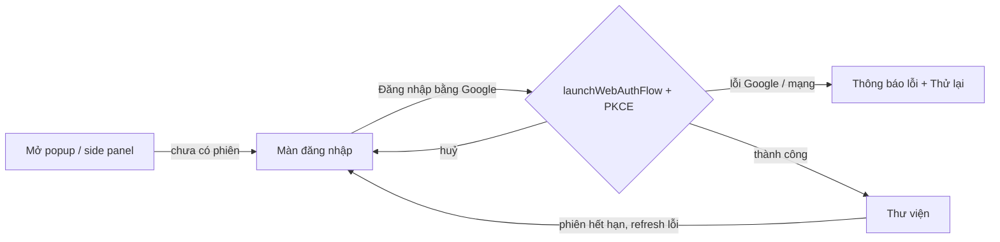
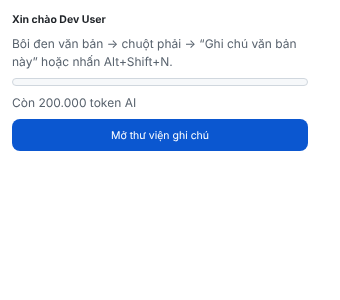

## Luồng 2 — Ghi chú nhanh + hoàn tác (SDS §5.1.2, kịch bản #1)
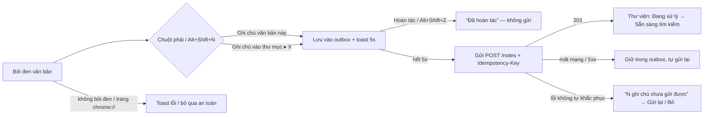
| Toast trên trang (CSS trang cố tình phá — vẫn hiển thị đúng) | Sau khi hoàn tác |
|---|---|
| 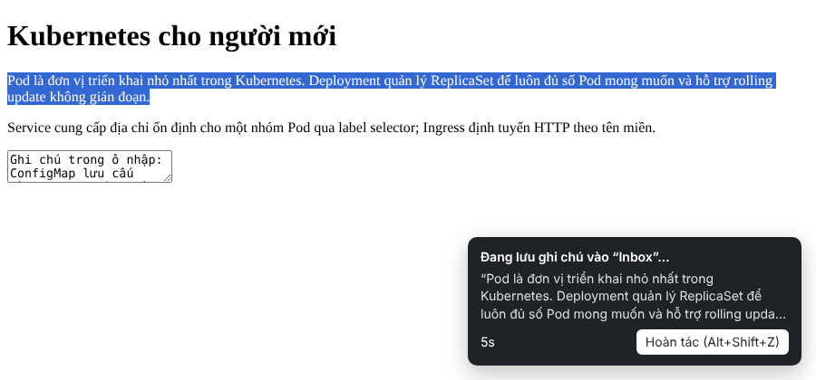 | 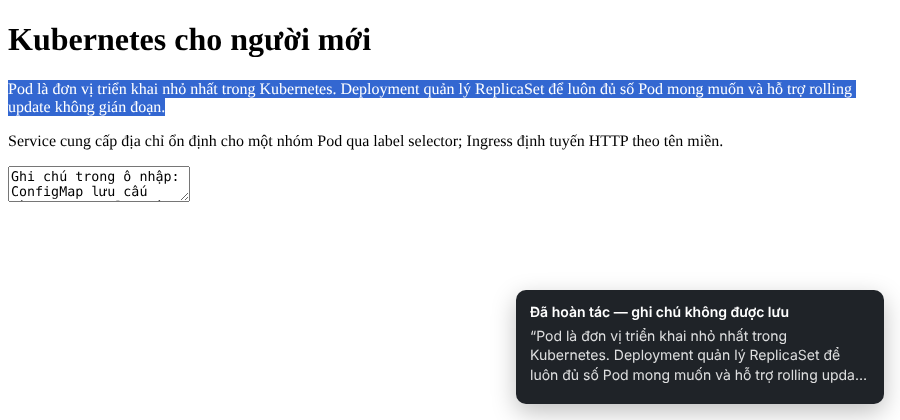 |

## Luồng 3 — Thư viện & thư mục (kịch bản #3, #5)
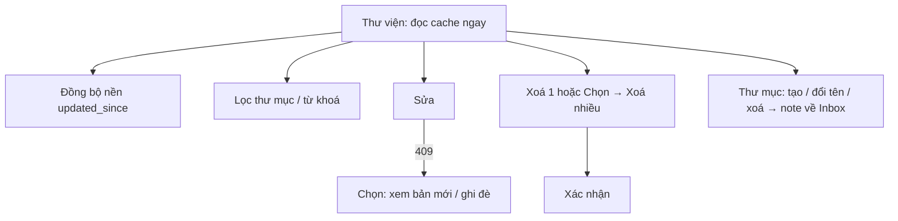
| Trống | Có dữ liệu + ghi chú chưa gửi | Danh sách chưa gửi |
|---|---|---|
| 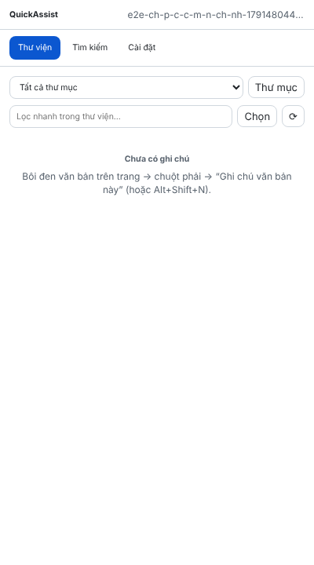 | 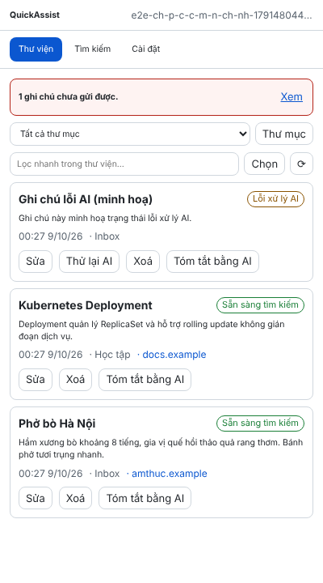 | 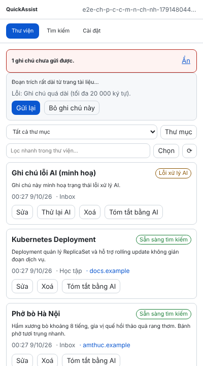 |

| Sửa | Xung đột 409 | Thư mục | Chọn nhiều |
|---|---|---|---|
| 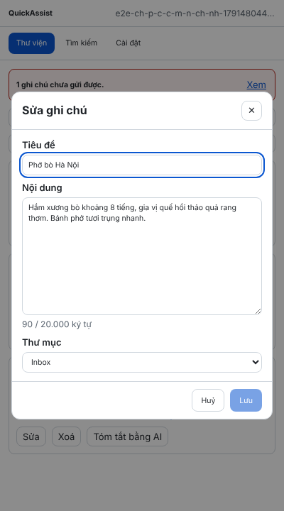 | 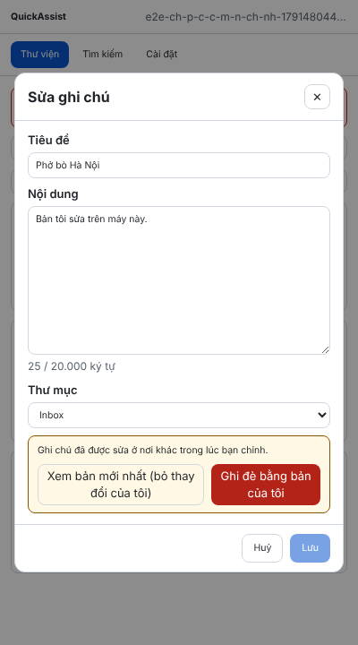 | 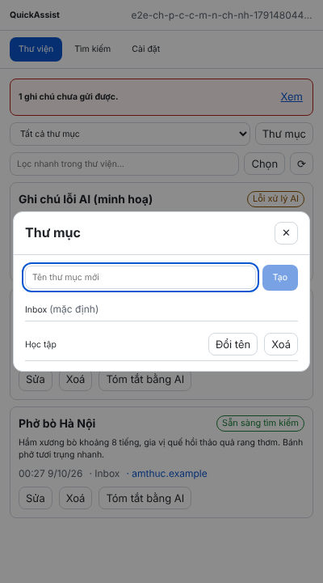 | 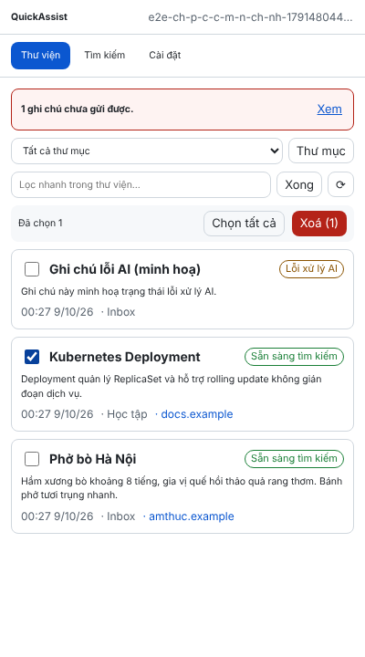 |

## Luồng 4 — Tìm kiếm ngữ nghĩa (SDS §5.1.3, kịch bản #4)
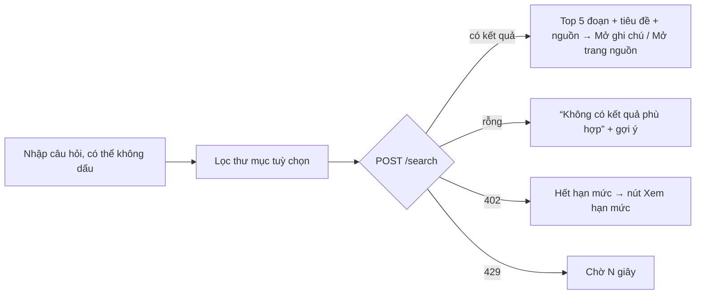
| Kết quả (gõ không dấu) | Không có kết quả | Hết quota |
|---|---|---|
| 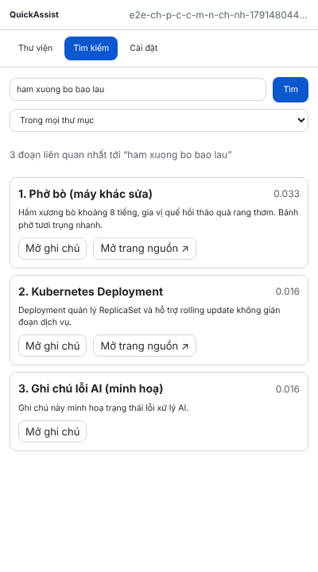 | 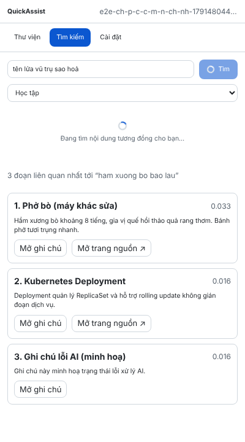 | 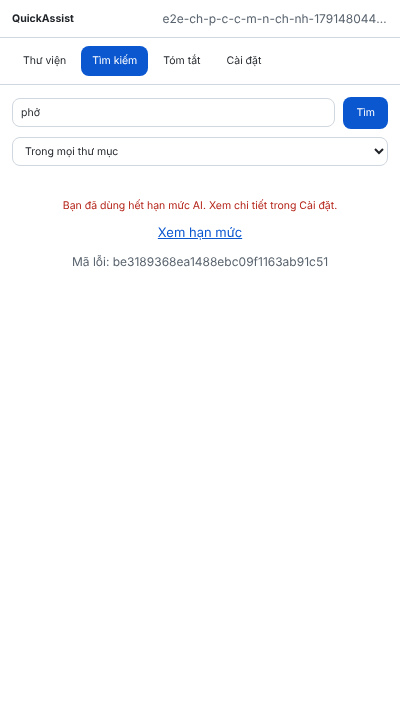 |

## Luồng 5 — Tóm tắt (SDS §5.1.4, đặc tả SUM-01)
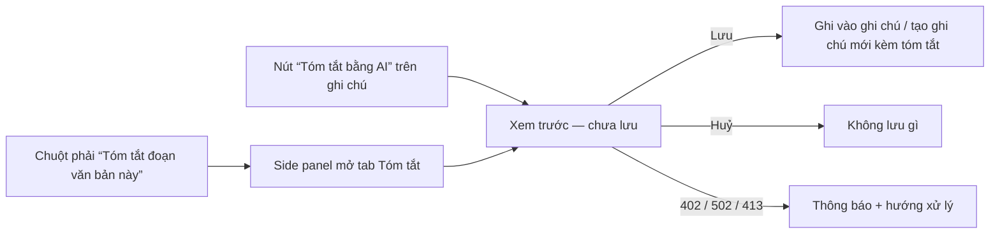
| Trên thẻ ghi chú | Vùng chọn |
|---|---|
| 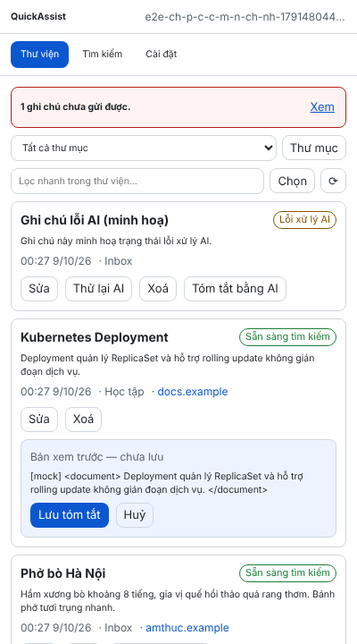 | 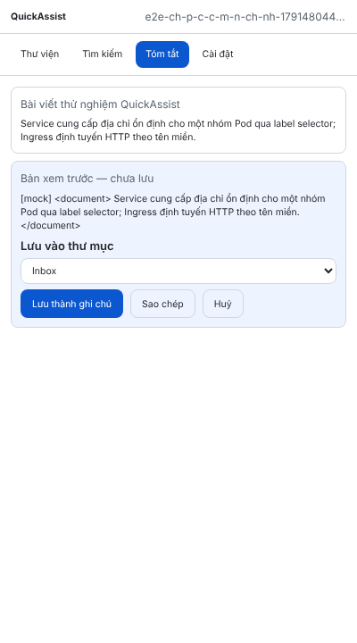 |

*(Ảnh chụp với AI mock nên nội dung tóm tắt là chuỗi lặp lại đầu vào.)*

## Luồng 6 — Cài đặt & xoá tài khoản (SDS §5.1.5)
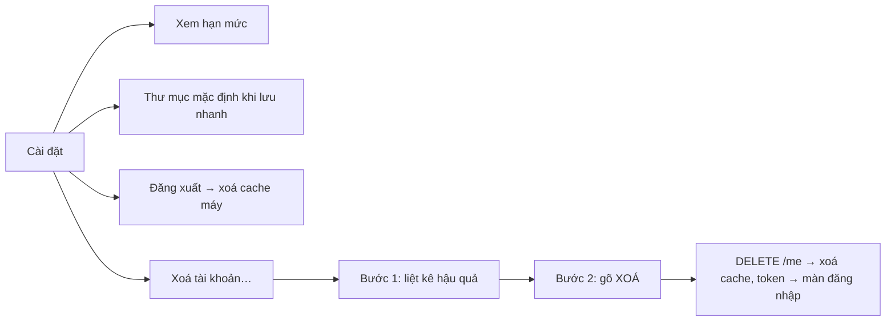
| Cài đặt (gần hết quota) | Xoá tài khoản bước 2 |
|---|---|
| 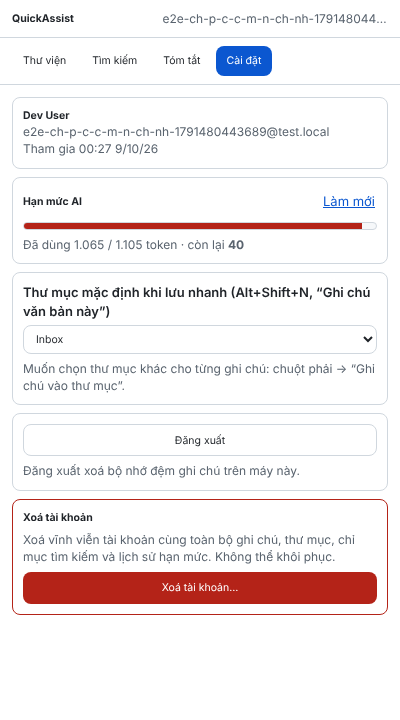 | 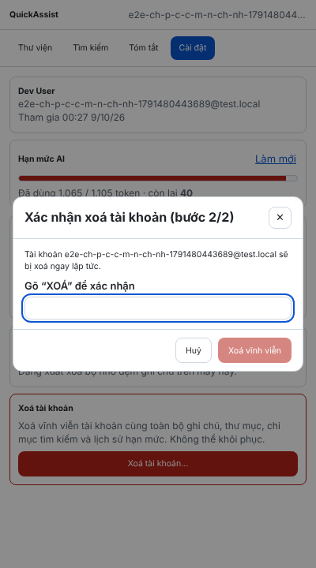 |

## Ma trận trạng thái đã bao phủ
| Màn | Loading | Empty | Error | Undo | Hết quota | Offline |
|---|---|---|---|---|---|---|
| Lưu nhanh (toast) | — | toast "hãy bôi đen" | toast lỗi / failed store | ✅ | SKIPPED, vẫn lưu | outbox |
| Thư viện | ✅ | ✅ | ✅ (Thử lại) | — | nhãn "Bỏ qua (hết quota)" + Thử lại AI | ✅ cache |
| Tìm kiếm | ✅ | ✅ | ✅ | — | ✅ + link Cài đặt | thông báo mạng |
| Tóm tắt | ✅ | ✅ | ✅ | Huỷ | ✅ + link Cài đặt | thông báo mạng |
| Cài đặt | ✅ | — | ✅ | 2 bước | thanh hạn mức + cảnh báo | hồ sơ từ cache |
