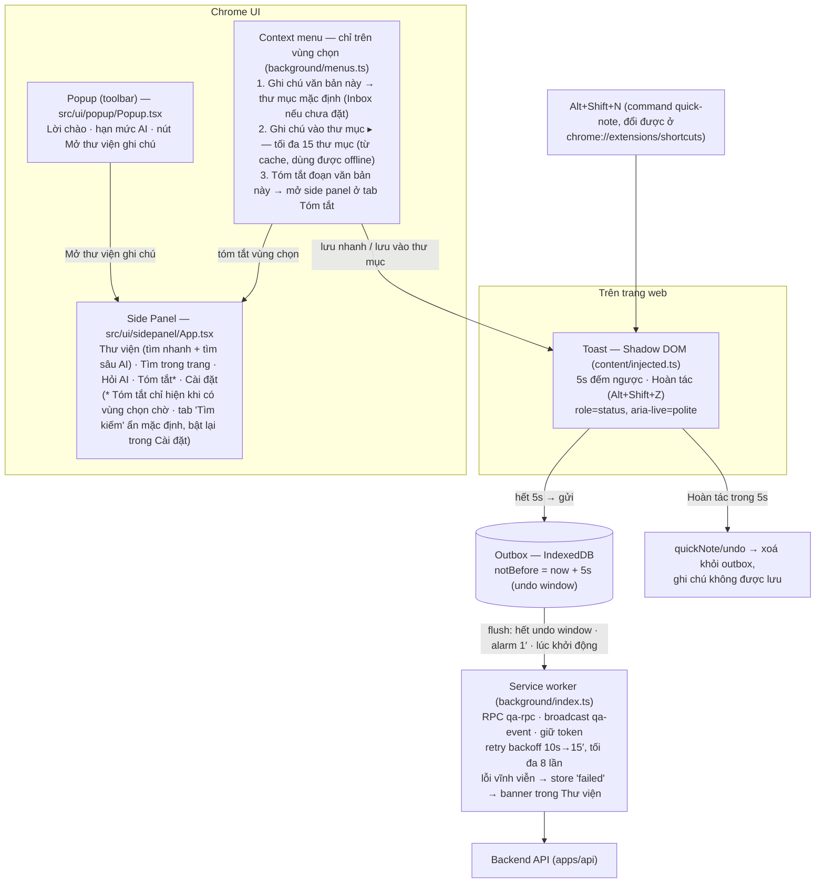
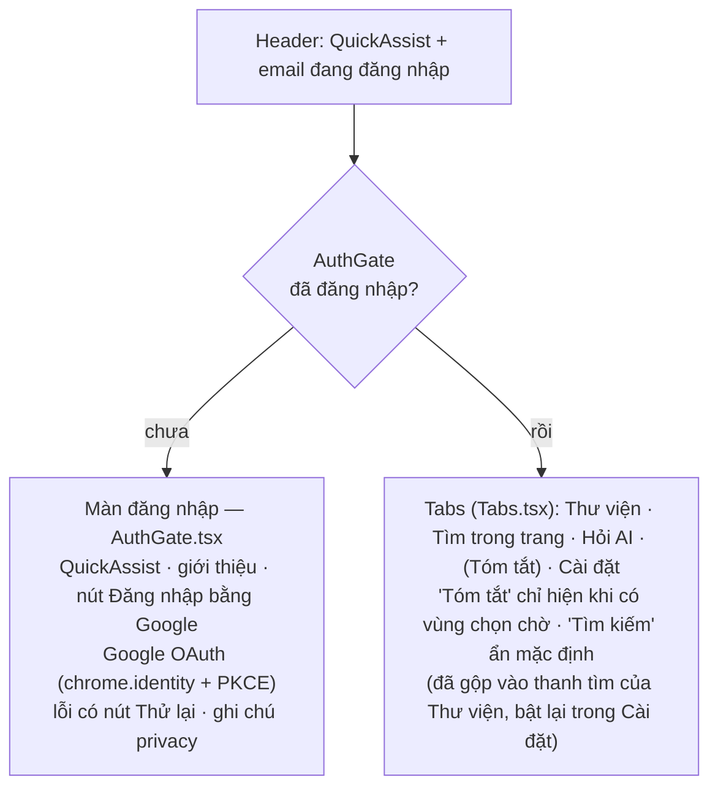
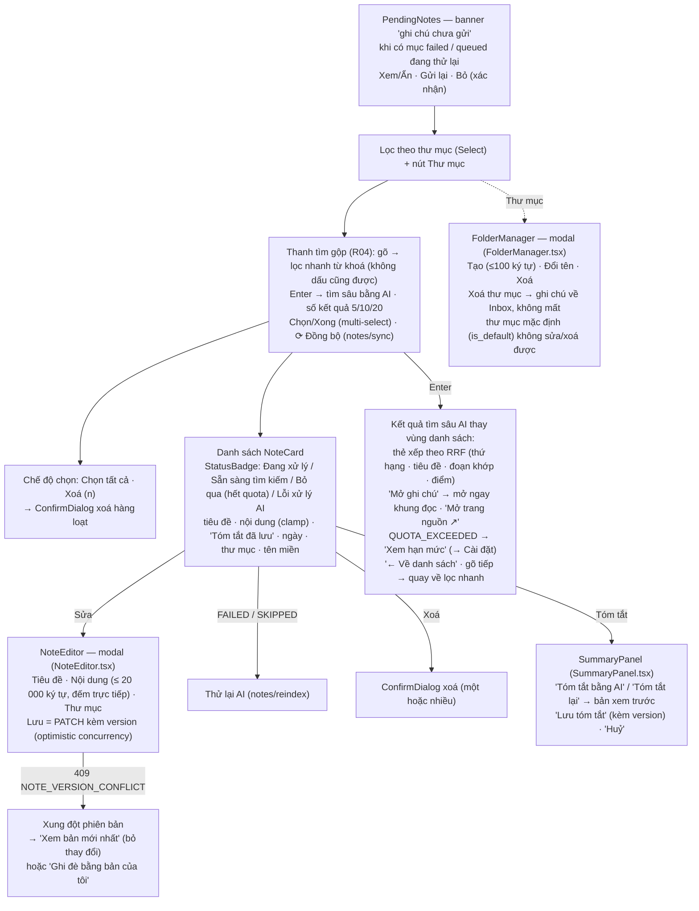
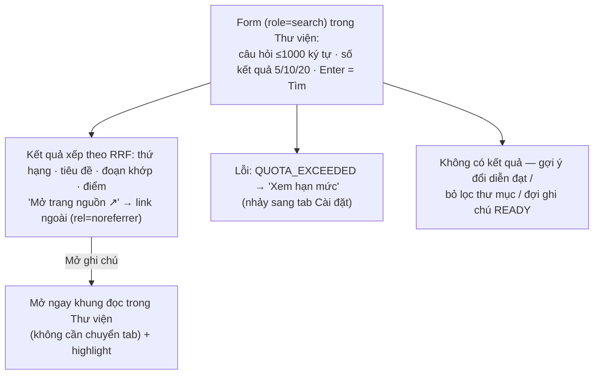
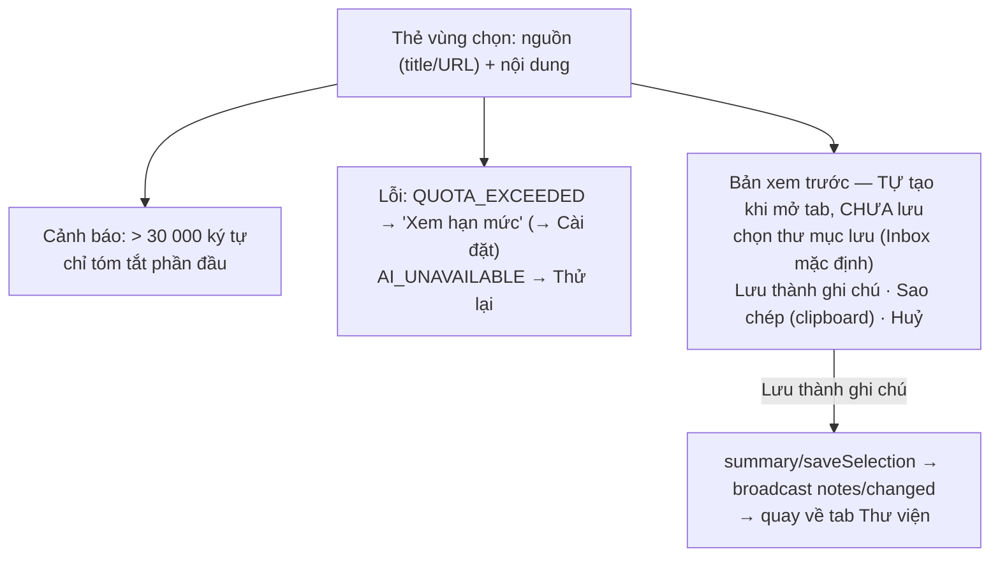
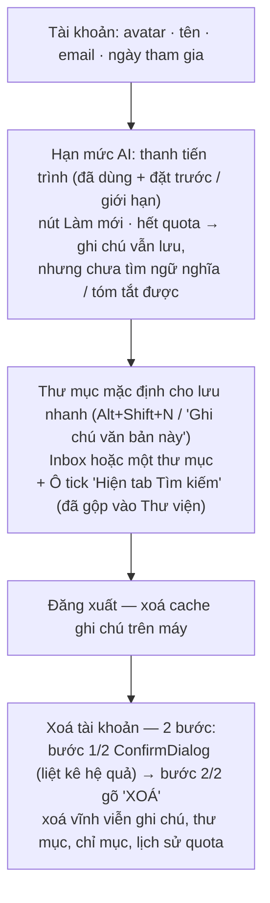
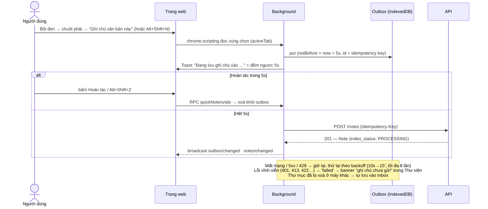
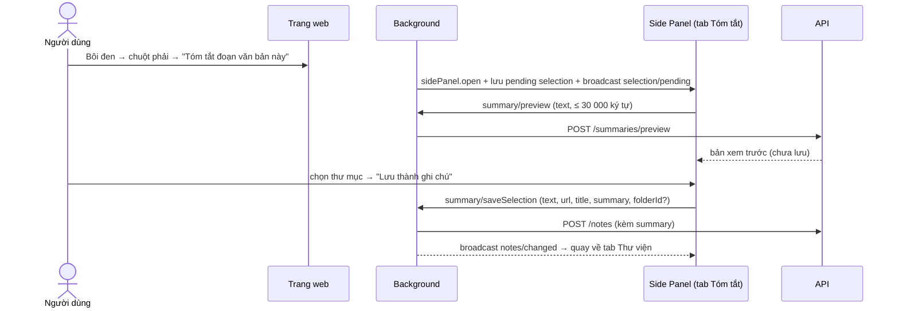
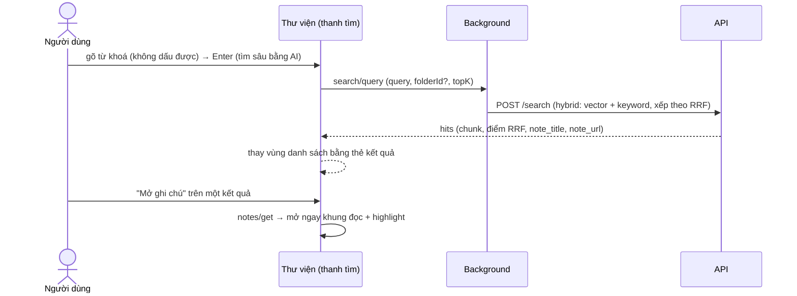

# Bản đồ UI QuickAssist Extension

Map nhanh các **màn hình** và **chức năng** của extension hiện có (MV3, `apps/extension`).
UI gọi background qua RPC (`qa-rpc`) — UI không gọi API trực tiếp; background giữ token,
outbox (IndexedDB) và phát broadcast (`qa-event`) cho mọi UI đang mở (ADR-0007).

Mở file này trong VS Code (Mermaid preview) hoặc GitHub để xem sơ đồ.
Ảnh chụp từng màn nằm trong `docs/ux/screens/`.

---

## 1. Tổng quan bề mặt (surfaces & điểm vào)

---

## 2. Side Panel — khung chung & đăng nhập

---

## 3. Tab Thư viện — `NotesView.tsx`

---

## 4. Tìm kiếm — gộp vào thanh tìm của Thư viện (R04)

Tìm kiếm ngữ nghĩa đã gộp vào **thanh tìm kiếm của tab Thư viện**: gõ → lọc nhanh trong danh sách
đã tải; nhấn **Enter** → gọi `search/query` (AI) với chính từ khoá đó + thư mục đang chọn.
Tab "Tìm kiếm" riêng (`SearchView.tsx`) **ẩn mặc định** — bật lại bằng tuỳ chọn trong Cài đặt
(`showSearchTab`), khi đó vẫn hành xử như mô tả dưới đây.

---

## 5. Tab Tóm tắt — `SelectionSummary.tsx`

Chỉ xuất hiện khi người dùng chọn **“Tóm tắt đoạn văn bản này”** trên trang (side panel mở sẵn).

---

## 6. Tab Cài đặt — `SettingsView.tsx`

---

## 7. Các luồng chính

### 7.1 Ghi chú nhanh (kịch bản #1)

### 7.2 Tóm tắt đoạn văn bản (SUM-03)

### 7.3 Tìm kiếm ngữ nghĩa → mở ghi chú

---

## 8. Kiểm kê chức năng (RPC — `shared/messaging/protocol.ts`)

| Nhóm | RPC | Dùng ở đâu |
|---|---|---|
| Auth | `auth/status` · `auth/login` · `auth/logout` · `account/delete` | AuthGate · Cài đặt |
| Quota | `quota/get` | Popup · Cài đặt |
| Tuỳ chọn | `prefs/get` · `prefs/set` | Cài đặt (thư mục mặc định, hiện tab Tìm kiếm) · background khi lưu nhanh |
| Thư mục | `folders/list` · `folders/create` · `folders/rename` · `folders/delete` | Thư viện · Cài đặt · Tìm kiếm (tuỳ chọn) · context menu |
| Ghi chú | `notes/list` · `notes/get` · `notes/sync` · `notes/update` · `notes/delete` · `notes/reindex` | Thư viện · Tìm kiếm (tuỳ chọn) |
| Outbox | `outbox/list` · `outbox/retry` · `outbox/discard` · `quickNote/undo` | PendingNotes · Toast |
| Tìm kiếm | `search/query` | Thư viện (Enter = tìm sâu) · Tìm kiếm (tuỳ chọn) |
| Tóm tắt | `summary/preview` · `summary/save` · `summary/saveSelection` · `selection/takePending` | SummaryPanel · Tóm tắt · Side Panel shell |
| E2E only | `e2e/devLogin` | Chỉ bản build E2E (bị loại khỏi bản phát hành) |

Broadcast (`qa-event`): `notes/changed` · `folders/changed` · `outbox/changed` · `selection/pending` · `session/changed`.

---

## 9. Kiểm kê màn hình ↔ file ↔ ảnh chụp

| # | Màn hình | File | Ảnh (`docs/ux/screens/`) |
|---|---|---|---|
| 1 | Popup | `src/ui/popup/Popup.tsx` | `01-popup.png` |
| 2 | Đăng nhập (dùng chung popup + side panel) | `src/ui/features/auth/AuthGate.tsx` | — |
| 3 | Thư viện — trống | `src/ui/features/notes/NotesView.tsx` | `02-thu-vien-trong.png` |
| 4 | Thư viện | `src/ui/features/notes/NotesView.tsx` | `03-thu-vien.png` |
| 5 | Ghi chú chưa gửi (offline/lỗi) | `src/ui/features/notes/PendingNotes.tsx` | `04-ghi-chu-chua-gui.png` |
| 6 | Sửa ghi chú | `src/ui/features/notes/NoteEditor.tsx` | `05-sua-ghi-chu.png` |
| 7 | Xung đột phiên bản 409 | `src/ui/features/notes/NoteEditor.tsx` | `06-xung-dot-409.png` |
| 8 | Quản lý thư mục | `src/ui/features/notes/FolderManager.tsx` | `07-quan-ly-thu-muc.png` |
| 9 | Chọn nhiều & xoá hàng loạt | `src/ui/features/notes/NotesView.tsx` | `08-chon-nhieu.png` |
| 10 | Tóm tắt — xem trước (trong thẻ) | `src/ui/features/summary/SummaryPanel.tsx` | `09-tom-tat-xem-truoc.png` |
| 11 | Tìm sâu bằng AI trong Thư viện | `src/ui/features/notes/NotesView.tsx` | `10-tim-kiem.png` |
| 12 | Tìm sâu — không có kết quả | `src/ui/features/notes/NotesView.tsx` | `11-tim-kiem-khong-co-ket-qua.png` |
| 13 | Tóm tắt vùng chọn | `src/ui/features/summary/SelectionSummary.tsx` | `12-tom-tat-vung-chon.png` |
| 14 | Toast trên trang | `src/content/injected.ts` | `13-toast-tren-trang.png` |
| 15 | Toast — Hoàn tác | `src/content/injected.ts` | `14-toast-hoan-tac.png` |
| 16 | Cài đặt | `src/ui/features/account/SettingsView.tsx` | `15-cai-dat.png` |
| 17 | Xoá tài khoản — bước 2/2 | `src/ui/features/account/SettingsView.tsx` | `16-xoa-tai-khoan-buoc-2.png` |
| 18 | Hết hạn mức AI | `src/ui/features/account/SettingsView.tsx` | `17-het-quota.png` |

---

## 10. Nền tảng dùng chung

- **Design system** (`src/ui/components/`): `Button` · `Field/Input/Select/TextArea` · `Modal/ConfirmDialog` · `Banner/EmptyState/ErrorState/ProgressBar/Spinner/StatusBadge` · `Tabs` · `Toast` (`ToastProvider`, token màu trong `styles.css`, tương phản WCAG AA được test tự động — `tests/contrast.test.ts`).
- **A11y**: `role=status/alert/tabpanel`, `aria-live`, focus-visible, toast là Shadow DOM cô lập CSS.
- **Phím tắt**: `Alt+Shift+N` — ghi chú nhanh; `Alt+Shift+Z` — hoàn tác (trong lúc toast hiện).
- **Chịu lỗi**: mọi màn có trạng thái loading / empty / error kèm "Thử lại"; ghi chú không bao giờ bị âm thầm xoá (outbox + `failed` store); xung đột ghi chú xử lý bằng version, không ghi đè im lặng.
- **Quyền tối thiểu**: không content script chạy sẵn trên mọi trang — chỉ `chrome.scripting` trên tab người dùng vừa thao tác (`activeTab`).
